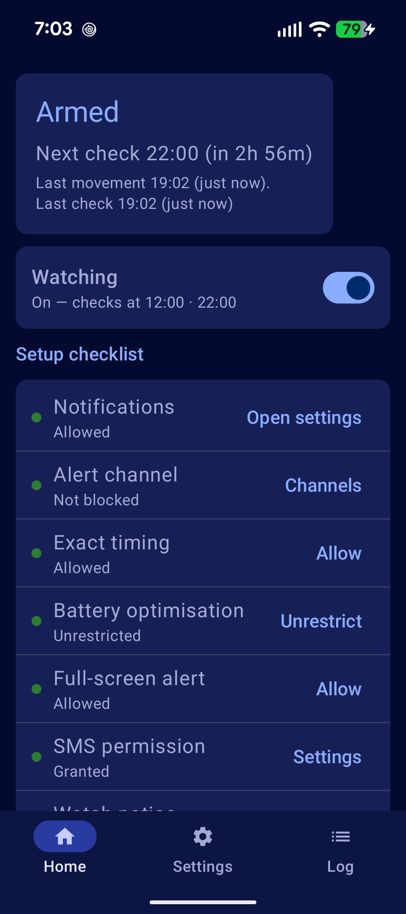
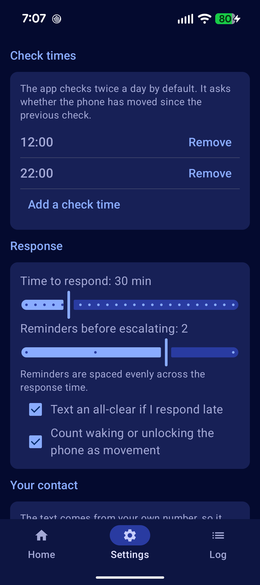
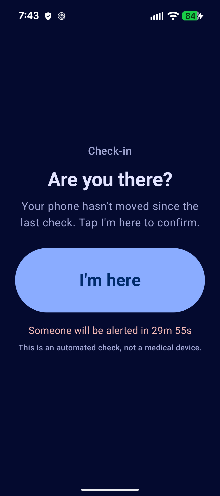

# WatchOver

[](https://github.com/jt-at-home/WatchOver/actions/workflows/build.yml)

**A quiet check-in, twice a day.**

At 12:00 and 22:00, WatchOver asks one question — *has this phone been picked up since the last check?* If it has, nothing happens. If it hasn't, the phone sounds an alert, lights its screen and asks you to tap **I'm here**. If you don't, it texts the person you nominated.

It's built for the ordinary worry of someone living alone: not a fall detector, not a medical device, just a daily "yes, I picked my phone up" that escalates when the answer stops coming.

<p align="center">
  
  &nbsp;
  
  &nbsp;
  
</p>

## Status

Working and tested on a Pixel 9a running Android 17, including a full end-to-end run through Doze. **Sideload only** — see [Limitations](#limitations).

- 74 unit tests, 5 instrumented tests, lint clean
- Measured battery cost: **~0.03 mAh/day** attributable, about 0.0006% of the battery
- 26 device findings written up in [docs/TEST-RESULTS.md](docs/TEST-RESULTS.md)

## How it works

```
22:00  check        has the phone moved since 12:00?
       ├─ yes  →      clear the flag, sleep until the next check
       └─ no   →      full-screen "I'm here" · screen held for 5 minutes
22:10  reminder      ring, wake the screen, hold it again
22:20  reminder      ring, wake the screen, hold it again
22:30  escalation    text your nominated contact
```

The whole decision is one latched flag:

```kotlin
// WatchService — any qualifying movement sets it
flag = true

// CheckInController — the next check consumes it
val outcome = CheckInDecision.decide(latchedMovement = flag, watchWasRunning = true)
```

Any single movement between two checks is enough — picking the phone up once at 18:48 covers the window until 22:00. A check *consumes* the flag, so the next window starts clean.

The fail-safe rule matters more than the happy path: if the watch service wasn't running, the interval was never observed, so the check **alerts** rather than silently passing.

## What's in it

- Two configurable check-in times a day (default 12:00 and 22:00)
- Hardware motion detection via `TYPE_SIGNIFICANT_MOTION`, falling back to motion-detect and then a batched accelerometer, plus screen-on and unlock as "the phone was handled"
- Exact alarms that survive Doze, an alarm-clock-class escalation deadline, and rescheduling after reboot, update, clock change or timezone change
- A full-screen alert that wakes a locked or dark screen and holds it for five minutes
- Reminders spaced evenly across the response window, each one re-lighting the screen
- SMS escalation with retries, delivery reports, and an optional all-clear when you answer late
- A setup checklist that reads real platform state, an event log, and test hooks

## Install

Android 13 or newer, and `adb` on your computer.

```bash
./gradlew assembleDebug
adb install -r app/build/outputs/apk/debug/app-debug.apk
```

Then follow [docs/INSTALL.md](docs/INSTALL.md) — the first-run checklist matters more than usual here. The two permissions that are easiest to get wrong:

| Permission | Why it's needed |
|---|---|
| **Notifications** | Without it the alert cannot be shown at all |
| **Alarms & reminders** | Exact timing; otherwise checks drift by minutes or hours |
| **Full-screen notifications** | Lets the alert wake a dark screen (Android 14+ special access) |
| **SMS** | The escalation |
| **Battery optimisation off** | Stops the system killing the watch service |

The app will not arm until the checklist is green, and it never asks for location — movement is motion, not GPS.

## Battery

Measured over 45 hours of real use: **0.0593 mAh**, about 0.0006% of a 5032 mAh battery per day, with 35 ms of wake locks in total. The sensor hub's own draw isn't attributed by Android; at the ~1 mW a significant-motion trigger uses, the realistic total is around **0.1%/day** — well inside the under-1%-per-day target.

The target is a *quiet-day* number. Alerts deliberately spend power: ringing, waking the screen and holding it are the feature, not overhead.

## Privacy

There is no server, no account and no analytics.

- **No `INTERNET` permission.** The app cannot reach the network at all — the SMS is handed to the carrier, not sent over data.
- **Everything stays on the phone.** Your contact's number, your check times and the event log live in the app's private storage.
- **No backup.** Android backup is disabled for this app, so that data is not copied to Google's servers either.
- **One sensor.** The motion sensor is the only one it reads, and the only thing recorded is a timestamp.
- **Uninstalling removes all of it.**

## How it's built

Kotlin and Jetpack Compose, with DataStore for persistence and nothing else — no Room, no Hilt, no WorkManager, no Google Play Services. Roughly 40 source files; the reasoning for each omission is in [docs/DESIGN.md](docs/DESIGN.md) §21.

```
app/src/main/java/com/watchover/
  schedule/   exact alarms, rescheduling after boot and time changes
  watch/      the foreground service and its sensor chain
  checkin/    the decision
  alert/      notification, full-screen activity, reminders
  escalate/   SMS, message text, delivery results
  data/       settings, runtime state, event log
  ui/         Compose screens and the setup checklist
```

## Testing

```bash
./gradlew testDebugUnitTest          # 74 pure JVM tests
./gradlew connectedDebugAndroidTest  # 5 instrumented tests, needs a device
./gradlew lintDebug                  # 0 errors
```

Debug builds expose an adb driver (`com.watchover.debug.CHECK`, `ACK`, `MOVE`, `SET_TIME`, …) so the app can be exercised without tapping through it. Every action is a no-op in release builds. Recipes are in [docs/INSTALL.md](docs/INSTALL.md).

## Limitations

- **Not a medical device.** Movement is not presence: someone can carry their phone and still need help. The app says so on the alert screen.
- **If the phone is off, flat, or out of signal, nothing happens.** The text is sent from the phone being watched, so a dead phone cannot report itself. Only a server-side heartbeat would fix that.
- **SMS only** in this version. Email is designed for — there is an `EscalationChannel` seam — but not built.
- **Sideload only.** The exact-alarm strategy relies on `USE_EXACT_ALARM`, which Google Play restricts to alarm-clock and calendar apps.
- **Android 13+**, phone-shaped devices. No widgets, no Wear, no iOS.
- The recipient installs nothing and only ever receives a text, so the message has to stand on its own.

## Documentation

| | |
|---|---|
| [docs/DESIGN.md](docs/DESIGN.md) | The full design: constraints, state machine, risk register, battery budget |
| [docs/INSTALL.md](docs/INSTALL.md) | Build, sideload, permissions, adb recipes, troubleshooting |
| [docs/TEST-RESULTS.md](docs/TEST-RESULTS.md) | 26 findings from testing on real hardware |
| [CONTRIBUTING.md](CONTRIBUTING.md) | Building, checks, and how the code is laid out |

## Licence

MIT — see [LICENSE](LICENSE).
